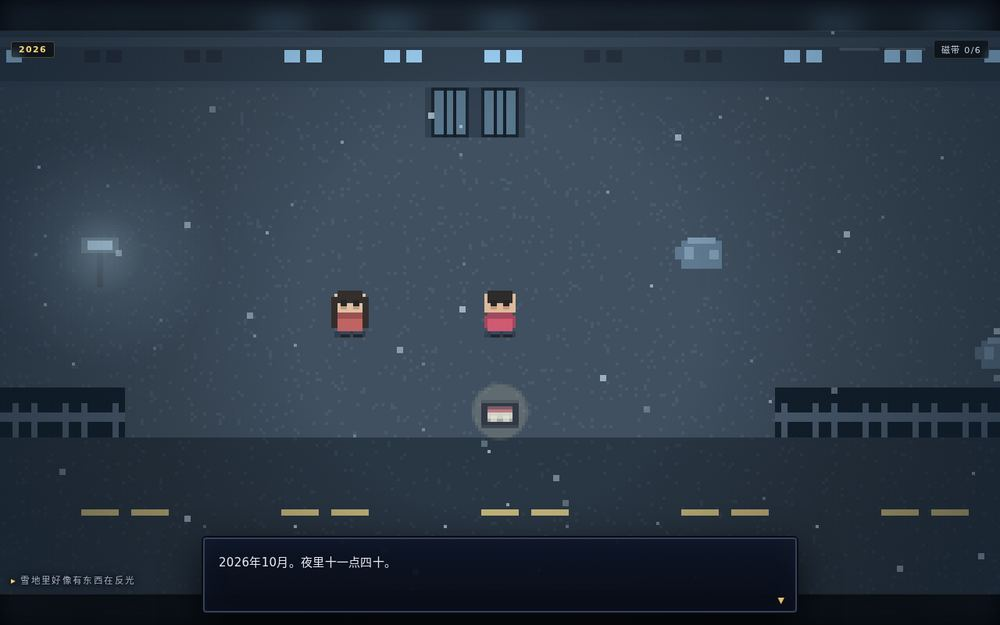
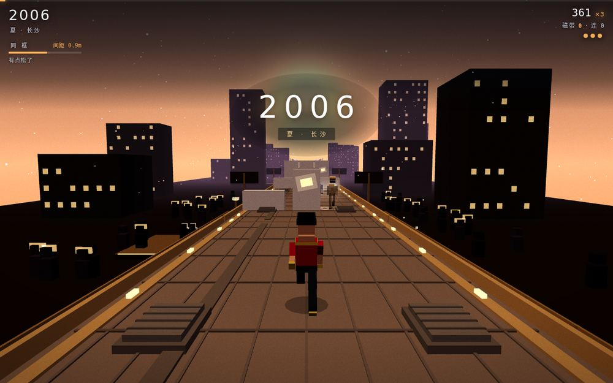
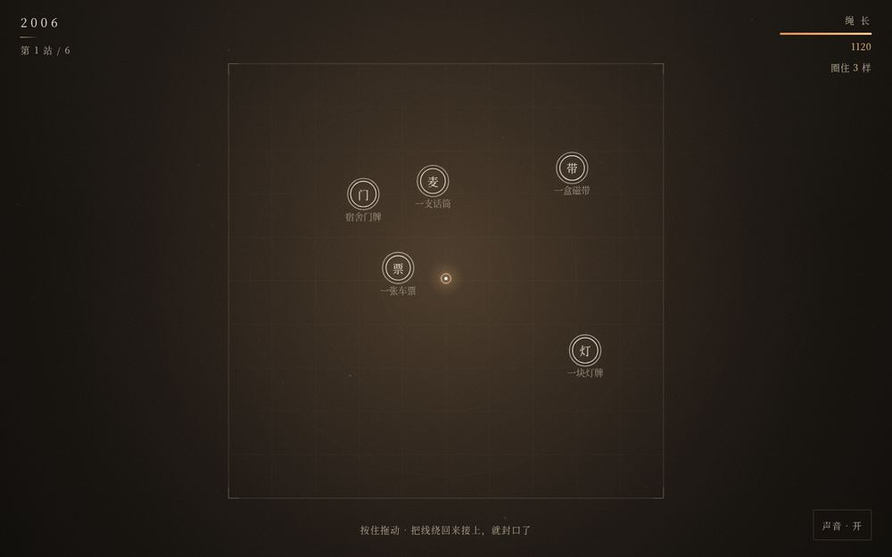
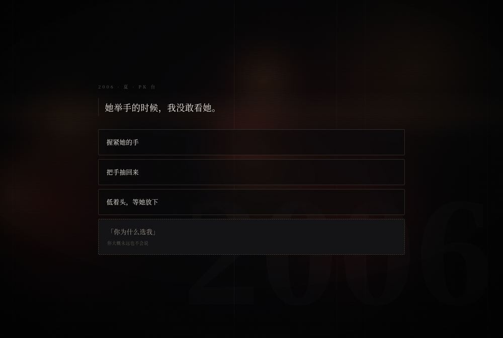
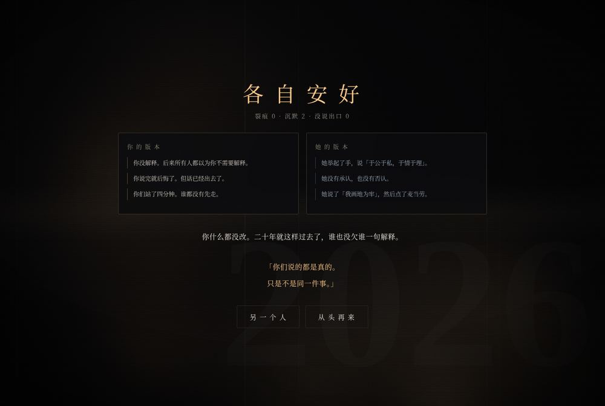
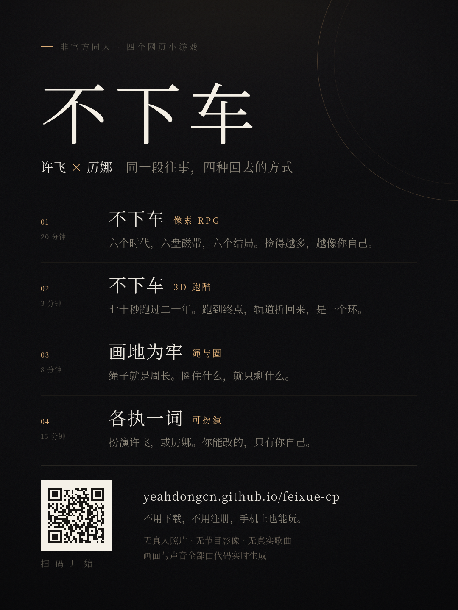
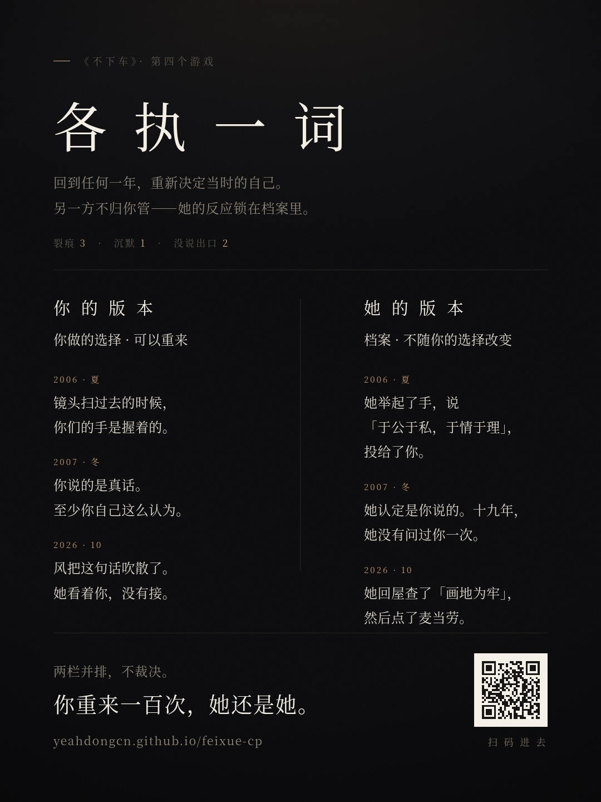
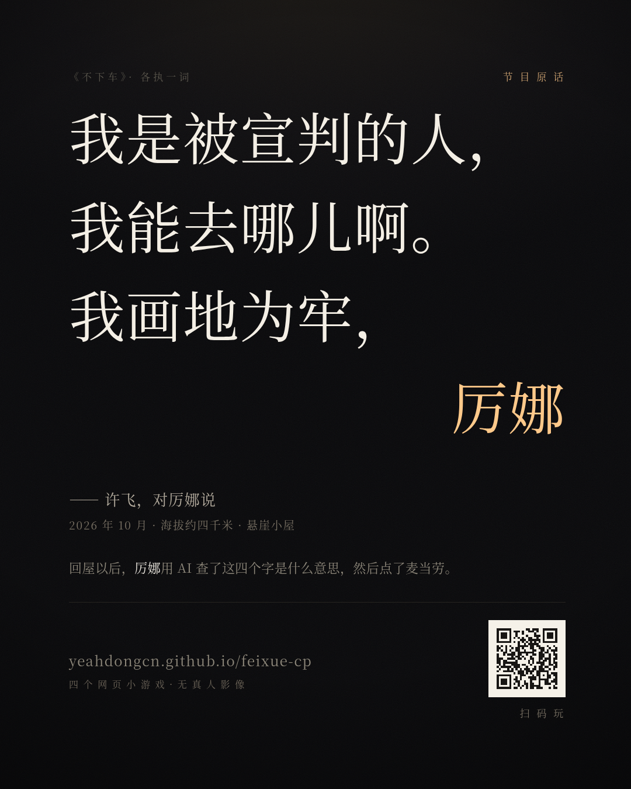
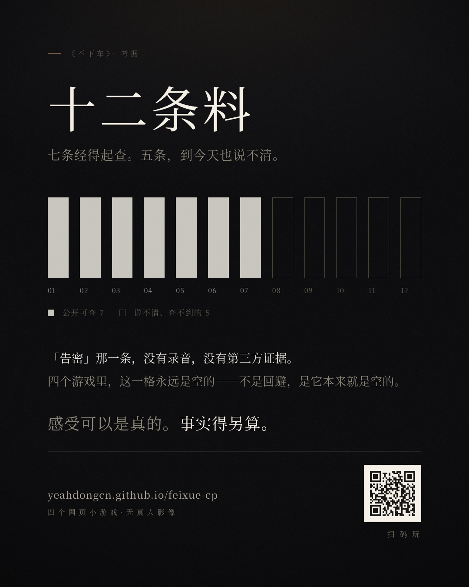

<div align="center">

# 不下车

**许飞 × 厉娜 · 同一段往事，四种回去的方式**

### [▶ 直接开始玩 →](https://yeahdongcn.github.io/feixue-cp/)

<sub>yeahdongcn.github.io/feixue-cp</sub>

<sub>不用下载，不用注册，手机上也能玩。所有画面与声音都是代码实时生成的，不含任何真人影像。</sub>

</div>

---

2006 年夏天，PK 台上，厉娜对着镜头说「于公于私，于情于理」，举起了许飞的手。

二十年后，她们在同一档节目里重新坐在一起。整季唯一一对没有下车的。

四个游戏，就是四个回到那趟车上的办法。玩法毫不相干，底色是同一份。

---

<table>
<tr>
<td width="52%"></td>
<td width="48%">

### 不下车 · 像素 RPG

六个时代，六盘磁带，三场战斗，六个结局。

你是一个粉丝，走进每一节车厢，把能捡的都捡起来。捡得越多，越像你自己。

**约 20 分钟** · 方向键 / 空格 · [开始玩 →](https://yeahdongcn.github.io/feixue-cp/buxiache-rpg/)

</td>
</tr>
</table>

<table>
<tr>
<td width="52%"></td>
<td width="48%">

### 不下车 · 3D 跑酷

在车顶上跑过六节车厢，七十秒跑完二十年。

你以为在往前，其实一直在同一个圈里——跑到终点，轨道折回来，是一个环。

**约 3 分钟** · ← → 换道，↑ 跳（落地前按下也算），↓ 滑铲（按住一直滑） · [开始玩 →](https://yeahdongcn.github.io/feixue-cp/buxiache-3d/dist/)

</td>
</tr>
</table>

<table>
<tr>
<td width="52%"></td>
<td width="48%">

### 画地为牢

**绳子就是周长。圈住什么，就只剩什么。**

按住拖动，把线绕回来接上自己，就封口了。六站，绳子一年比一年短。

最后一站，你只圈得住自己。

**约 8 分钟** · 鼠标 / 手指拖动 · [开始玩 →](https://yeahdongcn.github.io/feixue-cp/buxiache-draw/)

</td>
</tr>
</table>

<table>
<tr>
<td width="52%"></td>
<td width="48%">

### 各执一词

这一次你可以**扮演许飞，或者厉娜**。

回到任何一个年份，重新决定当时的自己怎么做。但另一方不归你管——她的反应锁在**档案**里。你重来一百次，她还是她。

**你只能改你自己。**

**约 15 分钟**（垂直切片）· 点击阅读 · [开始玩 →](https://yeahdongcn.github.io/feixue-cp/buxiache-two/)

</td>
</tr>
</table>



<div align="center"><sub>结局把你的版本和她的版本并排放，不裁决。</sub></div>

---

## 为什么是这四个

**同一个故事，四种靠近方式。**

像素 RPG 让你**捡**——所有关于她们的碎片都散在车厢里，你能带走的有限。
3D 跑酷让你**跑**——七十秒冲过二十年，最后发现是原地打转。
画地为牢让你**圈**——绳子越收越短，能圈住的东西一年比一年少。
各执一词让你**改**——你可以回到任何一年重来，但改得动的只有你自己。

四款游戏共享一个结论，但谁也不是靠说教得出的：

> 感受可以是真的。事实得另算。

---

## 关于事实

这个项目的地基是 [`buxiache/考据.md`](buxiache/考据.md)——把能查的都查了一遍，逐条标出哪些是公开可查的、哪些只是网友读出来的、哪些到今天仍然没有答案。

12 条料，经得起查的 7 条。

**「告密」这件事：** 厉娜指控许飞泄露了她解约、接私活的计划，导致她被雪藏近七年；许飞否认，被追问时松口「可能说过，不止我一个人接私活」。**没有录音，没有第三方证据。** 游戏里这一格永远是空的——不是回避，是它本来就是空的。

**「我画地为牢」：** 是许飞在海拔四千米的悬崖小屋说的，对着厉娜说的。「我是被宣判的人，我能去哪儿啊。我画地为牢，厉娜。」回屋后厉娜用 AI 查了这四个字的意思，然后点了麦当劳。

> 勘误：这两条在最早的版本里主语写反过（把告密写成了许飞指认、把「画地为牢」写成了厉娜说的）。四个游戏一起错了，已经全部改正。留着这句话，是因为这个项目最不该做的就是把错的说得理直气壮。

---

## 创作边界

- **不使用任何真人照片、节目 LOGO、节目影像或音频。** 所有视觉元素都是抽象符号：白 T 恤、吉他弦、雪花、列车窗、一根鞋带。
- **所有画面与声音由代码实时生成。** 噪点是 `ImageData` 随机像素，天空是着色器，音效是 WebAudio 现场合成。四款游戏里没有一个二进制素材文件。
- **不写私生活，不对任何真人下判断。** 四款游戏里，「告密」都只呈现为说不清，不给答案。
- **前三个游戏里，玩家是粉丝，不扮演真人。** 只有《各执一词》允许扮演，但那条设计是：你只能改你自己，她的反应锁死。

不是还原，是一次重构。

---

## 技术

四个游戏四种写法，共用一个原则：**单个 HTML 文件，零外部依赖，零网络请求。**

| | 实现 | 交付物 |
|---|---|---|
| 像素 RPG | Canvas 2D + 自绘像素精灵，内联剧本 | `buxiache-rpg/index.html`（85 KB） |
| 3D 跑酷 | three.js r158 内联，程序化几何 + 实例化 | `buxiache-3d/dist/index.html`（740 KB，gzip 190 KB） |
| 画地为牢 | 纯 Canvas 2D，凸包求解 + 绳子长度约束 | `buxiache-draw/index.html`（56 KB） |
| 各执一词 | DOM + Canvas，数据驱动剧本 | `buxiache-two/index.html`（60 KB） |

```bash
# 3D 跑酷需要构建
cd buxiache-3d && python3 build.py

# 其余三个双击就能玩
open buxiache-rpg/index.html
```

测试都是 headless 的，跑真浏览器或 DOM 模拟：

```bash
cd buxiache-rpg && node test/headless.js     # 21 项
cd buxiache-3d  && node test/world.js        # 世界与关卡
cd buxiache-draw && node test/levels.js      # 关卡可解性
cd buxiache-two && node test/run.js          # 40 项
```

---

## 目录

```
buxiache-rpg/     像素 RPG
buxiache-3d/      3D 跑酷（src/ 是源码，dist/ 是构建产物）
buxiache-draw/    画地为牢
buxiache-two/     各执一词（含 DESIGN.md 设计稿）
buxiache/         最早的文字 AVG 版 + 考据.md
docs/promo/       传播物料（四套文案 / 分享卡 / 风险清单）
index.html        入口页
tools/            截图与版式探针（开发用，不参与发布）
```

---

## 怎么传播

四张分享卡、四套文案、一份底线清单。都是现成的，拿去就能发。

<div align="center">


<sub>扫码，或直接打开 <a href="https://yeahdongcn.github.io/feixue-cp/">yeahdongcn.github.io/feixue-cp</a></sub>

</div>

<table>
<tr>
<td width="50%"><a href="docs/promo/share-cards/01-入口-四个游戏一图说清.png"></a><br><sub><b>入口卡</b> · 四个游戏一图说清</sub></td>
<td width="50%"><a href="docs/promo/share-cards/02-结局-你的版本她的版本.png"></a><br><sub><b>结局卡</b> · 你的版本 / 她的版本，并排，不裁决</sub></td>
</tr>
<tr>
<td width="50%"><a href="docs/promo/share-cards/03-金句-我画地为牢厉娜.png"></a><br><sub><b>金句卡</b> · 许飞对厉娜说的那句原话</sub></td>
<td width="50%"><a href="docs/promo/share-cards/04-考据-十二条料七条经得起查.png"></a><br><sub><b>考据卡</b> · 12 条料，经得起查的 7 条</sub></td>
</tr>
</table>

**文案在 [`docs/promo/launch.md`](docs/promo/launch.md)。** 微博、豆瓣小组、小红书、B 站专栏各一套，语气不同，不要一稿四投。

**发布前读一遍 [`docs/promo/risks.md`](docs/promo/risks.md)。** 哪些话绝对不能说、被质疑「消费真人」怎么回、为什么不用真实歌曲——都在里面。

三条最低限度的规矩：

1. **不说「揭秘」「真相」「实锤」。** 告密那件事没有录音，没有第三方证据。说成悬案，它才是诚实的。
2. **不 @ 当事人，不替她们判断关系，不拿雪藏玩梗。**
3. **不用真人照片、节目影像、节目 LOGO、任何真实歌曲**——包括「只截一小段」。

> 传播的时候，请把最后那句声明一起带上：**非官方同人，不构成对任何人的事实主张。**

---

<div align="center">
<sub>

非官方同人作品。人物是真实的公众人物，情节基于公开报道与节目画面改编，<strong>不构成对任何人的事实主张</strong>。<br>
请把她们当歌手——她们唱过歌，这就够了。

</sub>
</div>
